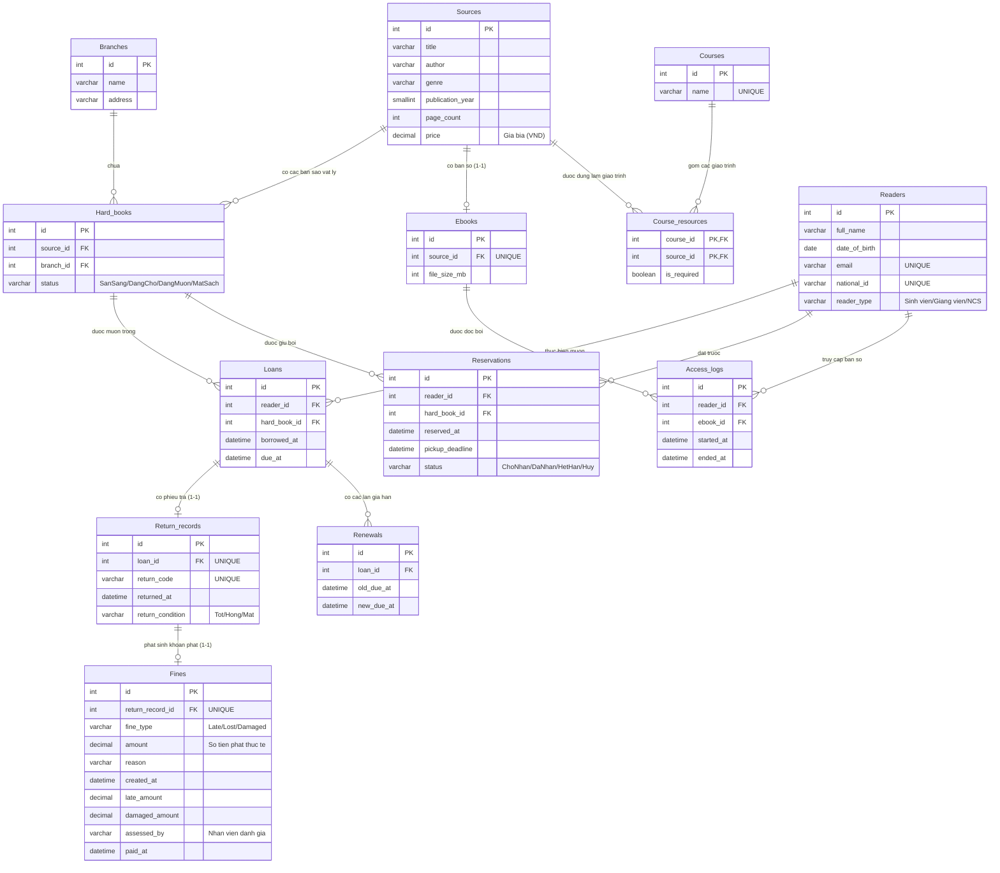

# TÀI LIỆU THIẾT KẾ VÀ MÔ TẢ CƠ SỞ DỮ LIỆU
## HỆ THỐNG QUẢN LÝ THƯ VIỆN SỐ ĐA CHI NHÁNH (LIBRARY MANAGEMENT SYSTEM)

Phiên bản: **2.1 (Không cho mượn lại bản sao đã mất)**
Hệ quản trị CSDL mục tiêu: **MySQL 8.0+ / MySQL 8.4 LTS**  
Quy ước đặt tên: Bảng số nhiều viết hoa (`Readers`, `Sources`), Khóa ngoại `<tên_bảng_số_ít>_id`, Dấu thời gian có hậu tố `_at`.

Database hiện có cần chạy `migration_lost_hard_book_status.sql` để bổ sung trạng thái sách mất, sửa các trigger liên quan và đánh dấu lại các bản sao có lần mượn gần nhất được ghi nhận là mất. Chạy migration này trước khi triển khai backend mới.

---

## 1. Sơ đồ Quan hệ Thực thể (ERD - Entity Relationship Diagram)



---

## 2. Từ điển Dữ liệu (Data Dictionary)

### 2.1. Bảng `Sources` (Đầu sách / Tài liệu chung)
Lưu trữ thông tin thư mục của tác phẩm dùng chung cho cả bản in vật lý và file điện tử.

| Tên cột | Kiểu dữ liệu | Ràng buộc | Ý nghĩa / Ghi chú |
| :--- | :--- | :--- | :--- |
| `id` | `INT` | `PK, AUTO_INCREMENT` | Mã tài liệu định danh nội bộ |
| `title` | `VARCHAR(255)` | `NOT NULL` | Tên tác phẩm / nhan đề sách |
| `author` | `VARCHAR(100)` | `NOT NULL` | Tên tác giả |
| `genre` | `VARCHAR(50)` | `NULL` | Thể loại sách (vd: Cơ sở dữ liệu, Trí tuệ nhân tạo) |
| `publication_year`| `SMALLINT` | `CHECK (1000..2100)` | Năm xuất bản |
| `page_count` | `INT` | `CHECK (> 0)` | Số trang |
| `price` | `DECIMAL(12,2)` | `NOT NULL DEFAULT 0.00, CHECK (>= 0)` | **Giá bìa hiện tại (VNĐ)** — Dùng chung cho mọi bản sao vật lý để tính tiền phạt |

### 2.2. Bảng `Hard_books` (Bản sao vật lý / Sách in)
Mỗi bản ghi đại diện cho 1 cuốn sách vật lý cụ thể tại 1 chi nhánh.

| Tên cột | Kiểu dữ liệu | Ràng buộc | Ý nghĩa / Ghi chú |
| :--- | :--- | :--- | :--- |
| `id` | `INT` | `PK, AUTO_INCREMENT` | Mã vạch / số định danh bản sao |
| `source_id` | `INT` | `FK -> Sources(id), NOT NULL` | Thuộc đầu sách nào |
| `branch_id` | `INT` | `FK -> Branches(id), NOT NULL`| Đang đặt tại chi nhánh nào |
| `status` | `VARCHAR(10)` | `NOT NULL DEFAULT 'SanSang', CHECK IN ('SanSang','DangCho','DangMuon','MatSach')` | Trạng thái hiện tại của bản sao |

### 2.3. Bảng `Ebooks` (Tài liệu điện tử)
Mỗi đầu sách có tối đa 1 bản mềm điện tử (quan hệ 1-1).

| Tên cột | Kiểu dữ liệu | Ràng buộc | Ý nghĩa / Ghi chú |
| :--- | :--- | :--- | :--- |
| `id` | `INT` | `PK, AUTO_INCREMENT` | Mã bản mềm |
| `source_id` | `INT` | `FK -> Sources(id), UNIQUE, NOT NULL` | Thuộc đầu sách nào |
| `file_size_mb` | `INT` | `CHECK (> 0)` | Dung lượng tệp PDF/EPUB (MB) |

### 2.4. Bảng `Branches` (Chi nhánh thư viện)
| Tên cột | Kiểu dữ liệu | Ràng buộc | Ý nghĩa / Ghi chú |
| :--- | :--- | :--- | :--- |
| `id` | `INT` | `PK, AUTO_INCREMENT` | Mã chi nhánh |
| `name` | `VARCHAR(100)` | `NOT NULL` | Tên chi nhánh |
| `address` | `VARCHAR(255)` | `NOT NULL` | Địa chỉ vật lý chi nhánh |

### 2.5. Bảng `Readers` (Độc giả)
| Tên cột | Kiểu dữ liệu | Ràng buộc | Ý nghĩa / Ghi chú |
| :--- | :--- | :--- | :--- |
| `id` | `INT` | `PK, AUTO_INCREMENT` | Mã độc giả |
| `full_name` | `VARCHAR(100)` | `NOT NULL` | Họ và tên |
| `date_of_birth` | `DATE` | `NOT NULL` | Ngày sinh (Trigger kiểm tra $\ge 16$ tuổi) |
| `email` | `VARCHAR(100)` | `NOT NULL, UNIQUE` | Email liên hệ |
| `national_id` | `VARCHAR(12)` | `NULL, UNIQUE` | Số CCCD |
| `reader_type` | `VARCHAR(20)` | `NOT NULL, CHECK IN ('Sinh vien','Giang vien','Nghien cuu sinh')` | Hạng độc giả |

### 2.6. Bảng `Loans` (Lượt mượn sách)
| Tên cột | Kiểu dữ liệu | Ràng buộc | Ý nghĩa / Ghi chú |
| :--- | :--- | :--- | :--- |
| `id` | `INT` | `PK, AUTO_INCREMENT` | Mã lượt mượn |
| `reader_id` | `INT` | `FK -> Readers(id), NOT NULL` | Độc giả mượn sách |
| `hard_book_id`| `INT` | `FK -> Hard_books(id), NOT NULL`| Bản sao vật lý được mượn |
| `borrowed_at` | `DATETIME` | `NOT NULL` | Thời điểm mượn |
| `due_at` | `DATETIME` | `NOT NULL, CHECK (due_at > borrowed_at)` | Hạn trả (được cập nhật khi gia hạn) |

### 2.7. Bảng `Renewals` (Lịch sử gia hạn)
| Tên cột | Kiểu dữ liệu | Ràng buộc | Ý nghĩa / Ghi chú |
| :--- | :--- | :--- | :--- |
| `id` | `INT` | `PK, AUTO_INCREMENT` | Mã lượt gia hạn |
| `loan_id` | `INT` | `FK -> Loans(id), NOT NULL` | Lượt mượn được gia hạn |
| `old_due_at` | `DATETIME` | `NOT NULL` | Hạn trả trước khi gia hạn |
| `new_due_at` | `DATETIME` | `NOT NULL, CHECK (new_due_at > old_due_at)` | Hạn trả mới sau khi gia hạn |

### 2.8. Bảng `Return_records` (Phiếu trả sách)
Mỗi lượt mượn có tối đa 1 phiếu trả (quan hệ 1-1).

| Tên cột | Kiểu dữ liệu | Ràng buộc | Ý nghĩa / Ghi chú |
| :--- | :--- | :--- | :--- |
| `id` | `INT` | `PK, AUTO_INCREMENT` | Mã phiếu trả nội bộ |
| `loan_id` | `INT` | `FK -> Loans(id), NOT NULL, UNIQUE` | Trả cho lượt mượn nào |
| `return_code` | `VARCHAR(30)` | `NOT NULL, UNIQUE` | Mã phiếu in cho độc giả |
| `returned_at` | `DATETIME` | `NOT NULL` | Thời điểm trả thực tế |
| `return_condition`| `VARCHAR(5)` | `NOT NULL DEFAULT 'Tot', CHECK IN ('Tot','Hong','Mat')` | Tình trạng khi trả: Tốt / Hỏng / Mất |

### 2.9. Bảng `Fines` (Khoản phạt)
Mỗi phiếu trả sách phát sinh tối đa 1 khoản phạt (quan hệ 1-1).

| Tên cột | Kiểu dữ liệu | Ràng buộc | Ý nghĩa / Ghi chú |
| :--- | :--- | :--- | :--- |
| `id` | `INT` | `PK, AUTO_INCREMENT` | Mã khoản phạt |
| `return_record_id`| `INT` | `FK -> Return_records(id), UNIQUE` | Phiếu trả phát sinh khoản phạt |
| `fine_type` | `VARCHAR(10)` | `NOT NULL, CHECK IN ('Late','Lost','Damaged')` | Loại phạt: Quá hạn / Mất sách / Hỏng |
| `amount` | `DECIMAL(12,2)`| `NOT NULL, CHECK (amount >= 0)` | Số tiền phạt thực tế (VNĐ) |
| `reason` | `VARCHAR(255)`| `NOT NULL` | Lý do / chi tiết vi phạm |
| `created_at` | `DATETIME` | `NOT NULL DEFAULT CURRENT_TIMESTAMP` | Thời điểm ghi nhận phạt |
| `late_amount` | `DECIMAL(12,2)`| `NOT NULL DEFAULT 0.00, CHECK (>= 0)` | Cấu phần quá hạn ghi nhận |
| `damaged_amount`| `DECIMAL(12,2)`| `NULL, CHECK (IS NULL OR >= 0)` | Mức phạt hư hại do nhân viên nhập |
| `assessed_by` | `VARCHAR(100)` | `NULL` | Nhân viên đánh giá tình trạng sách hỏng |
| `paid_at` | `DATETIME` | `NULL` | Thời điểm độc giả nộp phạt (`NULL` = chưa nộp) |

### 2.10. Bảng `Reservations` (Đặt trước bản cứng)
| Tên cột | Kiểu dữ liệu | Ràng buộc | Ý nghĩa / Ghi chú |
| :--- | :--- | :--- | :--- |
| `id` | `INT` | `PK, AUTO_INCREMENT` | Mã lượt đặt trước |
| `reader_id` | `INT` | `FK -> Readers(id), NOT NULL` | Độc giả đặt |
| `hard_book_id`| `INT` | `FK -> Hard_books(id), NOT NULL`| Bản sao đang giữ chỗ |
| `reserved_at` | `DATETIME` | `NOT NULL` | Thời điểm đặt giữ |
| `pickup_deadline`| `DATETIME` | `NOT NULL, CHECK (deadline > reserved_at)`| Hạn chót độc giả đến nhận |
| `status` | `VARCHAR(10)` | `NOT NULL DEFAULT 'ChoNhan', CHECK IN ('ChoNhan','DaNhan','HetHan','Huy')` | Trạng thái đặt chỗ |

### 2.11. Bảng `Courses` & `Course_resources` (Giáo trình môn học)
- **`Courses`**: `id INT PK`, `name VARCHAR(100) NOT NULL UNIQUE`.
- **`Course_resources`**: `course_id INT FK`, `source_id INT FK`, `is_required BOOLEAN NOT NULL DEFAULT TRUE`, Khóa chính tổ hợp: `PRIMARY KEY (course_id, source_id)`.

### 2.12. Bảng `Access_logs` (Nhật ký truy cập Ebook)
- `id INT PK`, `reader_id INT FK`, `ebook_id INT FK`, `started_at DATETIME NOT NULL`, `ended_at DATETIME NULL CHECK (ended_at IS NULL OR ended_at >= started_at)`.

### 2.13. View `v_active_loans` (Danh sách sách đang mượn)
```sql
CREATE VIEW v_active_loans AS
SELECT l.*
FROM Loans l LEFT JOIN Return_records r ON r.loan_id = l.id
WHERE r.id IS NULL;
```

---

## 3. Danh mục Toàn bộ Triggers Nghiệp vụ

| Tên Trigger | Bảng | Thời điểm | Mô tả nghiệp vụ |
| :--- | :--- | :--- | :--- |
| `trg_readers_age_ins` | `Readers` | `BEFORE INSERT` | Chặn tạo độc giả nếu chưa đủ 16 tuổi |
| `trg_readers_age_upd` | `Readers` | `BEFORE UPDATE` | Chặn cập nhật ngày sinh nếu tuổi < 16 |
| `trg_loans_before` | `Loans` | `BEFORE INSERT` | Kiểm tra: (1) Bản sao MatSach không được mượn; (2) Bản sao không ở trạng thái DangMuon; (3) Bản sao DangCho chỉ người đặt mới được mượn; (4) Sinh viên mượn tối đa 5 cuốn; (5) Tổng tiền phạt chưa nộp không vượt quá 100.000đ |
| `trg_loans_after` | `Loans` | `AFTER INSERT` | Chuyển `Hard_books.status` sang `'DangMuon'`; cập nhật `Reservations.status` sang `'DaNhan'` |
| `trg_renewals_before` | `Renewals`| `BEFORE INSERT` | Chặn gia hạn nếu sách đã trả hoặc hạn cũ không khớp |
| `trg_renewals_after` | `Renewals` | `AFTER INSERT` | Cập nhật hạn trả mới `Loans.due_at = NEW.new_due_at` |
| `trg_returns_before` | `Return_records` | `BEFORE INSERT` | Kiểm tra ngày trả thực tế phải $\ge$ ngày mượn |
| `trg_returns_after` | `Return_records` | `AFTER INSERT` | (1) Sách mất chuyển sang `MatSach`; các tình trạng khác về `SanSang`; (2) **Tính phạt tự động**: Lost = 100% giá bìa; Hong = không tự động phạt; Late = 10% giá bìa $\times$ số ngày quá hạn (nếu điều kiện Tot) |
| `trg_fines_before_ins`| `Fines` | `BEFORE INSERT` | Chặn tạo 2 khoản phạt trùng lặp trên cùng 1 phiếu trả |
| `trg_reservations_before`| `Reservations` | `BEFORE INSERT` | Chặn đặt trước nếu sách không ở trạng thái `SanSang` |
| `trg_reservations_after` | `Reservations` | `AFTER INSERT` | Chuyển `Hard_books.status` sang `'DangCho'` |
| `trg_reservations_update`| `Reservations` | `AFTER UPDATE` | Khi đặt trước đổi thành `HetHan` hoặc `Huy` $\rightarrow$ Trả sách về `'SanSang'` |

---

## 4. Nghiệp vụ Tính Tiền Phạt Chi Tiết

$$
\text{fine\_type} = 
\begin{cases} 
\text{Lost} & \text{khi } \text{return\_condition} = \text{'Mat'} \implies \text{Tiền phạt} = 100\% \times \text{Sources.price} \\
\text{Damaged} & \text{khi } \text{return\_condition} = \text{'Hong'} \implies \text{Không tự động; Nhân viên kiểm tra và nhập} \\
\text{Late} & \text{khi } \text{return\_condition} = \text{'Tot'} \text{ và } \text{overdue\_days} > 0 \implies \text{Tiền phạt} = 10\% \times \text{Sources.price} \times \text{overdue\_days} \\
\text{Không phạt} & \text{khi trả đúng/trước hạn hoặc sách bình thường}
\end{cases}
$$

*Quy tắc loại trừ:*
- Nếu sách vừa quá hạn vừa bị mất $\rightarrow$ **Chỉ phạt tiền mất sách (100% giá bìa)**, hoàn toàn không tính thêm phí quá hạn.
- Mỗi lần trả sách chỉ được tạo **tối đa 1 khoản phạt**.
